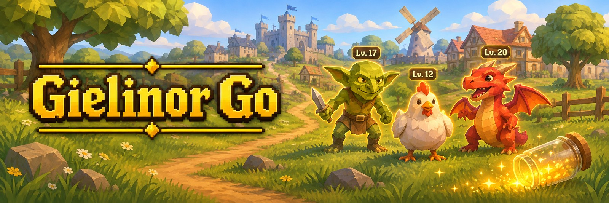

  

<h1 align="center">Gielinor Go</h1>

Gielinor Go is a RuneLite plugin that adds a creature-raising side game to Old School RuneScape. Monsters near you
sometimes turn wild. Catch one and it joins a team of six that levels up from the XP you earn in any skill, learns
moves, evolves, and fights wild creatures, eight City Champions and your friends' teams. Battles play themselves
unless you ask to choose each turn, so you can keep skilling while one runs.

Everything is drawn on your own screen. The plugin never clicks or acts for you, and no real monster is hidden or
changed. This page is the short version: every rule and number is in the [full guide](docs/GUIDE.md).

<!--
IMAGE 01 · docs/img/01-wild-creature.png · full width · THE HERO SHOT, the first thing a new reader sees
Capture: the whole RuneLite window with the Gielinor Go side panel open on the Team tab. In the game view, a wild
creature (outlined, with its level tag) stands near its real monster, and your lead creature stands behind you.
Pick a place people know (Lumbridge goblins or cows) in daylight, with the camera zoomed in enough that the outline
and the level tag are easy to read.
Then replace this comment with:

  

-->

## Getting started

1. Open the **Plugin Hub** in RuneLite, search for **Gielinor Go** and click **Install**.
2. Click the Gielinor Go icon in the sidebar to open the panel. You start with 10 Bronze jars.
3. Walk near monsters until one turns wild: a smaller, outlined copy with a level tag appears beside it.
4. Right-click the copy and choose **Catch** to throw a jar. The menu shows your odds.
5. Once you have a creature, left-click a wild one to **Battle** it. Click it again while it lies knocked out to
   throw a jar at twice the odds.

## Features

### Wild creatures and jars

- **Monsters near you turn wild**

  A wild creature is its own smaller copy that stands beside the real monster for about three minutes. There are
  1,094 species to find, from chickens to bosses. Wild creatures do not appear inside instances.

- **Catch them with jars**

  Right-click a wild creature to see your odds before you throw. Stronger monsters are harder to catch, a
  knocked-out creature is twice as easy, and better jars (Bronze, Iron, Rune, Dragon) improve your chance. Walking,
  level-ups and battle wins earn more jars.

- **Specialty jars**

  Eleven more jars turn up while skilling, each much better on one kind of creature: Mining finds Cave jars for
  creatures underground, Prayer finds Blessed jars for undead and demons, and so on.

<!--
IMAGE 02 · docs/img/02-catch-menu.png · about 60% width
Capture: the right-click menu on a wild creature, showing Battle and Catch with the catch odds, and a specialty jar
option if you own one that fits. Crop to the creature and the menu.
Then replace this comment with:

  

-->

<!--
IMAGE 03 · docs/img/03-jar-throw.png · about 60% width
Capture: a jar in the air between your character and a knocked-out wild creature, or the "Caught!" text floating
over the creature just after. Catch effects must be on (the default).
Then replace this comment with:

  

-->

### Your team

- **Your XP trains your creatures**

  Every XP drop you earn, in any skill, also trains your team of up to six. The lead creature learns twice as fast
  and walks a step behind you.

- **Every creature is one of a kind**

  Each creature rolls hidden bonuses for health, attack, defence and speed, and one of ten temperaments. The best
  are rated Strong or Exceptional. You can give any of them a nickname.

- **Moves and evolutions**

  A creature knows up to four moves and unlocks new ones as it levels: a dragon bites at level 1 and uses
  Dragonfire at 20. Many species evolve too. An Imp becomes a Lesser demon, then a Greater demon, then a Black
  demon, and there are over 150 evolutions to find.

- **Eggs and gilded creatures**

  Battle wins sometimes drop an egg, which hatches once you have walked far enough. One wild creature in 500 is
  gilded, with a gold outline and a gold name.

<!--
IMAGE 04 · docs/img/04-team-tab.png · about 45% width (the panel is narrow), sits beside IMAGE 05
Capture: the side panel on the Team tab with a full team of six. Show portraits, health and XP bars, at least one
nickname, one rated creature (Strong or Exceptional), a gold "New move" line if you can, the eggs row and the daily
tasks under it. Crop to the panel only.

IMAGE 05 · docs/img/05-follower.png · about 45% width, sits beside IMAGE 04
Capture: your lead creature following your character, with its name floating above it. A recognisable creature
(a dragon or a demon) in an open area reads best. Crop close.
Then replace this comment with:

   

-->

### Battles

- **Battles that play themselves**

  Left-click a wild creature and your lead walks up and fights it in front of you. When one of your creatures
  faints, the next steps in by itself. Each hit floats over the creature that took it, so you can carry on with
  what you were doing while the battle runs.

- **Styles and status effects**

  Melee beats Ranged, Ranged beats Magic, and Magic beats Melee. Some moves poison, burn, freeze or stun.

- **Choose your own turns**

  Turn on **Choose battle actions** and each turn waits for you: **Attack**, **Switch**, **Catch**, **Item** or
  **Run**, from the panel or with hotkeys. Do nothing for 10 seconds and your creature attacks by itself.

<!--
IMAGE 06 · docs/img/06-battle-scene.png · full width
Capture: a battle in progress in the game view. Your lead and the wild creature face each other, with a damage
line floating over one of them ("Bob uses Dragonfire: -14"). A Ranged or Magic move with its arrow or bolt in the
air is the best frame. Battle animations must be on (the default).
Then replace this comment with:

  

-->

<!--
IMAGE 07 · docs/img/07-battle-box.png · about 45% width
Capture: the battle box at the top of the side panel during a battle with "Choose battle actions" on. Show both
health bars, the countdown bar, the five buttons and, if you can, a status tag (PSN, BRN) beside a name and the
move list open under Attack. Crop to the panel only.
Then replace this comment with:

  

-->

### Goals

- **Creature Log**

  Every species you have caught, seen or still need, with rewards at 25, 50, 100, 250 and 500 species.

- **Daily and weekly tasks**

  Three new tasks a day and one a week, paid the moment you finish them.

- **City Champions**

  From Lumbridge to Yanille, eight cities each have a champion with a team of three and a sigil to win.

- **Elite challenge**

  Hold all eight sigils, then fight five trainers back to back with no resting to earn the title **Grand
  Champion**.

- **Daily events**

  A few featured species turn wild more often each day, unholy creatures do at night, and every weekend boosts one
  group, such as dragons or goblins.

<!--
IMAGE 08 · docs/img/08-creature-log.png · about 45% width, sits beside IMAGE 09
Capture: the Log tab with the Today section at the top (featured species and the weekend event), the "Next: N
species" progress bar, and a mix of caught, seen and missing species below. Crop to the panel only.

IMAGE 09 · docs/img/09-battle-tab.png · about 45% width, sits beside IMAGE 08
Capture: the Battle tab showing City Champion cards, with at least one sigil already won and one champion you can
challenge. If you hold all eight sigils, include the Elite challenge card. Crop to the panel only.
Then replace this comment with:

   

-->

### Friends

Join a RuneLite party and everyone in it who plays Gielinor Go shows up on your Battle tab. Challenge a friend's
team, or trade creatures and eggs.

<!--
IMAGE 10 · docs/img/10-friends.png · about 45% width · optional, needs a second player in your party
Capture: the Battle tab with a friend's card showing their name, trainer level and team, with the Challenge and
Trade buttons. An open trade offer with Accept and Decline is the best frame. Crop to the panel only, and check
that the friend is happy for their name to be shown.
Then replace this comment with:

  

-->

## Only on your screen

- **The plugin never plays for you.** It sends no clicks, no key presses and no game actions.
- **Nothing real is touched.** Wild creatures, your follower and battle scenes are drawn for you alone. No real
  monster is hidden, moved or changed, and other players see none of it.
- **Your save stays on your computer.** There is no server and no account.
- **Friends are opt-in.** Only if you join a RuneLite party does the plugin send your team, your trainer level,
  the rarities of your eggs and your trade offers, and only to that party. Nicknames are never sent.
- **Off in PvP by default.** Nothing extra is on your screen or in your menus in the Wilderness or on PvP worlds
  unless you turn on **Play in PvP areas**.

## Settings

| Setting | Default | What it does |
|---|---|---|
| Wild creature rarity | 1 in 8 | How often a nearby monster turns wild. Lower numbers mean more wild creatures. |
| Choose battle actions | Off | Each battle turn waits for you instead of playing itself. |
| Battle animations | On | Battles are acted out in the game view. Off shows them as floating text. |
| Lead creature follows you | On | Your lead walks a step behind you. |
| Also print to chat | Off | Writes catches, battles and rewards to your chatbox as well. Only you see them. |
| Sounds | On | A short game sound for a catch, a level-up, an evolution and other big moments. Uses the game's sound effect volume. |

The rest of the settings are described in the [full guide](docs/GUIDE.md).

## Links

- [Full guide](docs/GUIDE.md)
- [Report a bug](https://github.com/Oveduumnakal/Gielinor-Go-Plugin/issues/new?template=bug_report.yml)
- [Request a feature](https://github.com/Oveduumnakal/Gielinor-Go-Plugin/issues/new?template=feature_request.yml)
- [Buy me a coffee](https://buymeacoffee.com/oveduumnakal)
